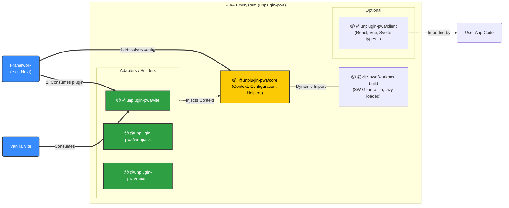
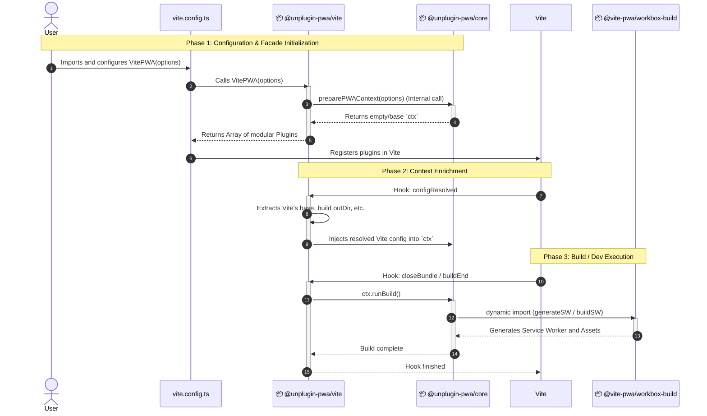
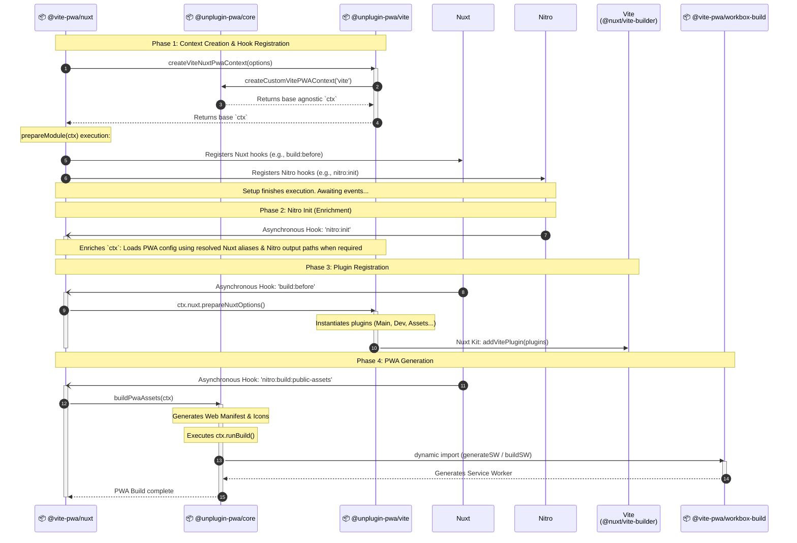

# The Architecture Diagram

## Vanilla Vite Lifecycle Diagram (Execution Flow)

## Nuxt + Vite Lifecycle Diagram (Execution Flow)

> [!TIP]
> **On Lifecycle Execution:**
> While the sequence diagram represents a chronological flow, it is important to understand that the architecture is highly **event-driven**. During Phase 1, the Nuxt Module (`@vite-pwa/nuxt`) only resolves the initial context and synchronously registers the lifecycle hooks. The execution is not blocking or strictly sequential thereafter. Phases 2, 3, and 4 are executed asynchronously in complete isolation whenever the underlying Nuxt and Nitro reach those specific milestones in their internal build processes.

